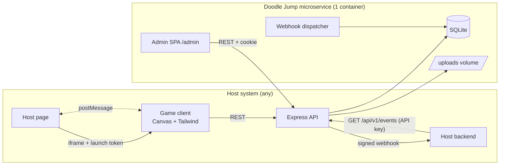
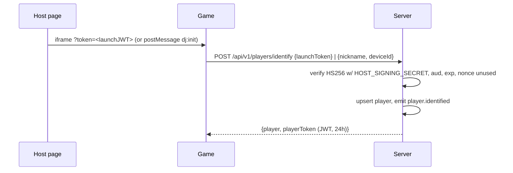
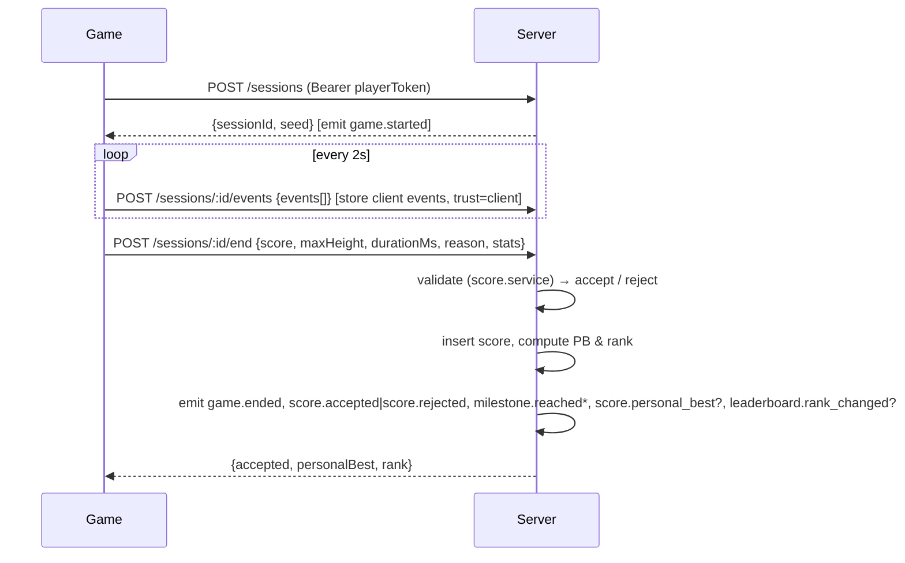

# Architecture

## 1. Overview

One deployable unit (Docker image) containing:

- **Express API server** (Node.js 24, ES modules) — public game API, integration API, admin API, static hosting, webhook dispatcher worker.
- **Game client** — vanilla JS + Canvas, built by Vite, Tailwind for DOM overlays.
- **Admin SPA** — vanilla JS + Tailwind, built by Vite as a second entry point.
- **SQLite** database (`better-sqlite3`, WAL mode) on a mounted volume, plus an `uploads/` directory for theme assets.



## 2. Technology Choices

| Concern | Choice | Reason |
|---|---|---|
| Runtime | Node.js 24 LTS, ES modules | Single language across stack |
| HTTP | Express 5 | Familiar, minimal |
| Validation | zod (shared between client & server via `shared/`) | One schema for env, requests, theme, events |
| DB | SQLite via `better-sqlite3` | Zero-ops, synchronous & fast; repository layer allows PostgreSQL later |
| Auth tokens | `jose` (JWT HS256) | Admin session, player token, host launch token |
| Uploads | `multer` (memory) + `file-type` sniffing + `sharp` (raster normalise) + `dompurify`/`jsdom` (SVG sanitise) | Safe asset handling |
| Security headers | `helmet`, `cors`, `express-rate-limit` | Standard hardening |
| Logging | `pino` + `pino-http` | Structured JSON logs |
| Frontend build | Vite 6 + `@tailwindcss/vite` (Tailwind v4) | Fast dev, multi-page build |
| Tests | Vitest, Supertest, Playwright | See [TESTING.md](TESTING.md) |

## 3. Repository Layout

```
.
├─ server/
│  ├─ index.js                 # boot: load env, migrate, start HTTP + workers, graceful shutdown
│  ├─ app.js                   # express app factory (used by tests)
│  ├─ config/env.js            # zod-validated env (fails fast)
│  ├─ db/
│  │  ├─ connection.js         # better-sqlite3, WAL, pragmas
│  │  ├─ migrate.js            # runs migrations/*.sql in order, tracks schema_migrations
│  │  └─ migrations/001_init.sql
│  ├─ repositories/            # ONLY place with SQL
│  │  ├─ players.repo.js  sessions.repo.js  scores.repo.js  events.repo.js
│  │  └─ themes.repo.js   assets.repo.js    settings.repo.js webhooks.repo.js
│  ├─ services/                # business logic, no req/res
│  │  ├─ auth.service.js       # admin login, token issue/verify, launch-token verify
│  │  ├─ player.service.js     session.service.js  score.service.js (anti-cheat)
│  │  ├─ leaderboard.service.js event.service.js   webhook.service.js
│  │  └─ theme.service.js      asset.service.js    settings.service.js
│  ├─ routes/
│  │  ├─ public.routes.js      # /api/v1/config, players, sessions, leaderboard
│  │  ├─ integration.routes.js # /api/v1/events, /api/v1/players/:externalUserId/stats
│  │  └─ admin.routes.js       # /api/v1/admin/*
│  ├─ middleware/
│  │  ├─ adminAuth.js playerAuth.js apiKey.js validate.js rateLimit.js errorHandler.js requestId.js
│  └─ workers/webhookDispatcher.js
├─ client/
│  ├─ index.html               # game entry
│  ├─ admin/index.html         # admin entry
│  ├─ styles/tailwind.css
│  ├─ game/
│  │  ├─ main.js
│  │  ├─ engine/   loop.js input.js camera.js rng.js assets.js audio.js collision.js
│  │  ├─ entities/ player.js platform.js item.js monster.js blackHole.js projectile.js
│  │  ├─ world/    world.js generator.js difficulty.js
│  │  ├─ scenes/   boot.js menu.js play.js pause.js gameOver.js leaderboard.js nickname.js
│  │  ├─ net/      api.js eventQueue.js hostBridge.js
│  │  └─ theme/    loader.js
│  └─ admin/
│     ├─ main.js router.js api.js
│     ├─ pages/    login.js dashboard.js theme.js assets.js events.js leaderboard.js settings.js
│     └─ components/ table.js modal.js toast.js filePicker.js colorField.js
├─ shared/
│  ├─ constants.js             # physics, difficulty, milestones (GAME_DESIGN numbers)
│  ├─ eventTypes.js            # catalog + zod payload schemas (EVENTS.md)
│  └─ themeSchema.js           # theme JSON schema + default theme
├─ public/default-assets/      # bundled default sprites & sounds
├─ tests/ unit/ api/ e2e/
├─ docs/
├─ Dockerfile  docker-compose.yml  .env.example
├─ vite.config.js  package.json
```

Layering rule: `routes → services → repositories`. Routes never touch SQL; repositories never contain business rules.

## 4. Runtime Topology

| Path | Served by |
|---|---|
| `/` | `dist/index.html` (game) |
| `/admin`, `/admin/*` | `dist/admin/index.html` (SPA fallback) |
| `/assets/*` | Vite-built JS/CSS (immutable cache) |
| `/default-assets/*` | Bundled theme defaults |
| `/uploads/*` | Admin-uploaded assets (immutable, content-hashed names) |
| `/api/v1/*` | API ([API.md](API.md)) |
| `/health`, `/ready` | Liveness / readiness (DB ping) |

**Dev:** `npm run dev` runs Express on `PORT` (3000) and Vite on 5173 with proxy `/api`, `/uploads`, `/default-assets` → 3000.
**Prod:** `npm run build && npm start` — Express serves `dist/`.

## 5. Key Flows

### 5.1 Player identification


### 5.2 Run lifecycle


### 5.3 Event emission & delivery
1. `event.service.emit(type, {player, sessionId, data, trust})` validates payload against `shared/eventTypes.js`, inserts into `events` (assigns `seq`).
2. If webhook enabled and type passes the filter → inserts row in `webhook_deliveries` (status `pending`) in the **same transaction**.
3. `workers/webhookDispatcher.js` polls every 1 s, sends up to 20 pending deliveries concurrently, signs body, updates status, schedules retries (see [EVENTS.md](EVENTS.md) §6).
4. Pull consumers read `GET /api/v1/events?after=<seq>`.

### 5.4 Theme update
1. Admin uploads asset → `POST /admin/assets` → sniff, sanitise, hash, store as `/uploads/<sha256>.<ext>`, row in `assets`.
2. Admin edits draft → `PUT /admin/theme/draft` (validated by `themeSchema`).
3. Preview iframe loads `/?preview=draft` → game calls `GET /api/v1/config?preview=draft` (admin cookie required) and listens for `dj:preview_theme` postMessages for instant updates.
4. `POST /admin/theme/publish` → new immutable version, `published` pointer updated, emit `admin.theme_published`. `GET /api/v1/config` ETag changes; clients pick it up on next load.

## 6. Configuration (environment)

All read and validated in `server/config/env.js`. See `.env.example`.

| Variable | Required | Default | Purpose |
|---|---|---|---|
| `NODE_ENV` | no | `development` | |
| `PORT` | no | `3000` | |
| `PUBLIC_BASE_URL` | prod | `http://localhost:3000` | Absolute URLs for assets/webhooks |
| `ADMIN_USERNAME` | **yes** | — | Fixed admin login |
| `ADMIN_PASSWORD` | **yes** | — | Fixed admin password (≥ 12 chars in prod) |
| `ADMIN_JWT_SECRET` | **yes** | — | Signs admin session cookie (≥ 32 chars) |
| `ADMIN_SESSION_HOURS` | no | `8` | |
| `PLAYER_JWT_SECRET` | **yes** | — | Signs player tokens |
| `HOST_SIGNING_SECRET` | no | — | Verifies host launch tokens; if unset, only anonymous mode |
| `ALLOW_ANONYMOUS` | no | `true` | Allow nickname mode |
| `INTEGRATION_API_KEY` | no | — | Bearer key for integration API; if unset, integration API disabled |
| `WEBHOOK_URL` | no | — | Initial webhook target (admin can override in settings) |
| `WEBHOOK_SECRET` | no | — | HMAC secret for webhook signatures |
| `DB_PATH` | no | `./data/doodle.db` | |
| `UPLOAD_DIR` | no | `./data/uploads` | |
| `MAX_UPLOAD_MB` | no | `2` | Per asset (sounds up to 2× this) |
| `CORS_ORIGINS` | no | — | Comma list of host origins allowed to call the API cross-origin |
| `FRAME_ANCESTORS` | no | `'self'` | CSP `frame-ancestors` list; also used as allowed `postMessage` origins |
| `MAX_SCORE_RATE` | no | `450` | Max score points per second of run (anti-cheat) |
| `EVENT_RETENTION_DAYS` | no | `180` | Older events purged daily |
| `LOG_LEVEL` | no | `info` | |

Startup fails (exit 1, clear message) if required vars are missing, or in production if secrets are shorter than required.

## 7. Security Model

| Surface | Control |
|---|---|
| Admin API | Cookie `dj_admin` (httpOnly, `SameSite=Strict`, `Secure` in prod, JWT HS256, 8 h). Mutating requests also require header `X-Requested-With: dj-admin` (CSRF defence-in-depth). Login: `crypto.timingSafeEqual` on SHA-256 digests of username & password; rate limit 5/min/IP; generic error message; `admin.login_failed` event (no password logged). |
| Player API | `Authorization: Bearer <playerToken>`; session ownership checked on every session call; rate limit 60 req/min/player. |
| Integration API | `Authorization: Bearer <INTEGRATION_API_KEY>` (timing-safe compare); rate limit 600 req/min. |
| Launch tokens | HS256, `aud = "doodle-jump"`, `exp` ≤ 15 min from `iat`, `jti` single-use (stored 30 min). |
| Uploads | Size limit, MIME sniff (not extension), raster re-encode via `sharp` (strips metadata), SVG sanitised (no scripts, `foreignObject`, external refs). Served with `X-Content-Type-Options: nosniff` and `Content-Security-Policy: default-src 'none'; style-src 'unsafe-inline'; sandbox`. |
| Headers | helmet; CSP for app: `default-src 'self'; img-src 'self' data: blob:; media-src 'self'; connect-src 'self'; frame-ancestors ${FRAME_ANCESTORS}` |
| Data | No raw IPs stored; secrets never logged (pino redact paths). |

## 8. Scaling & Evolution

- v1: single container, SQLite WAL. Expected capacity: thousands of concurrent players, ~500 writes/s (events batched per request in one transaction).
- Horizontal scaling requires the PostgreSQL adapter (repositories implement the same interface) and moving the webhook dispatcher to a single leader (advisory lock) — planned for v2.
- Leaderboard cached in memory for 5 s per period; invalidated on accepted score.

## 9. Deployment

**Dockerfile** (multi-stage): `node:24-alpine` build stage (`npm ci && npm run build`) → runtime stage with `dist/`, `server/`, `shared/`, prod `node_modules`; `USER node`; `VOLUME /app/data`; `HEALTHCHECK CMD wget -qO- localhost:$PORT/health`.

**docker-compose.yml**: one service `doodle-jump`, `env_file: .env`, volume `./data:/app/data`, port `3000:3000`.

Graceful shutdown on SIGTERM: stop accepting connections, finish in-flight webhook sends (max 10 s), close DB.
