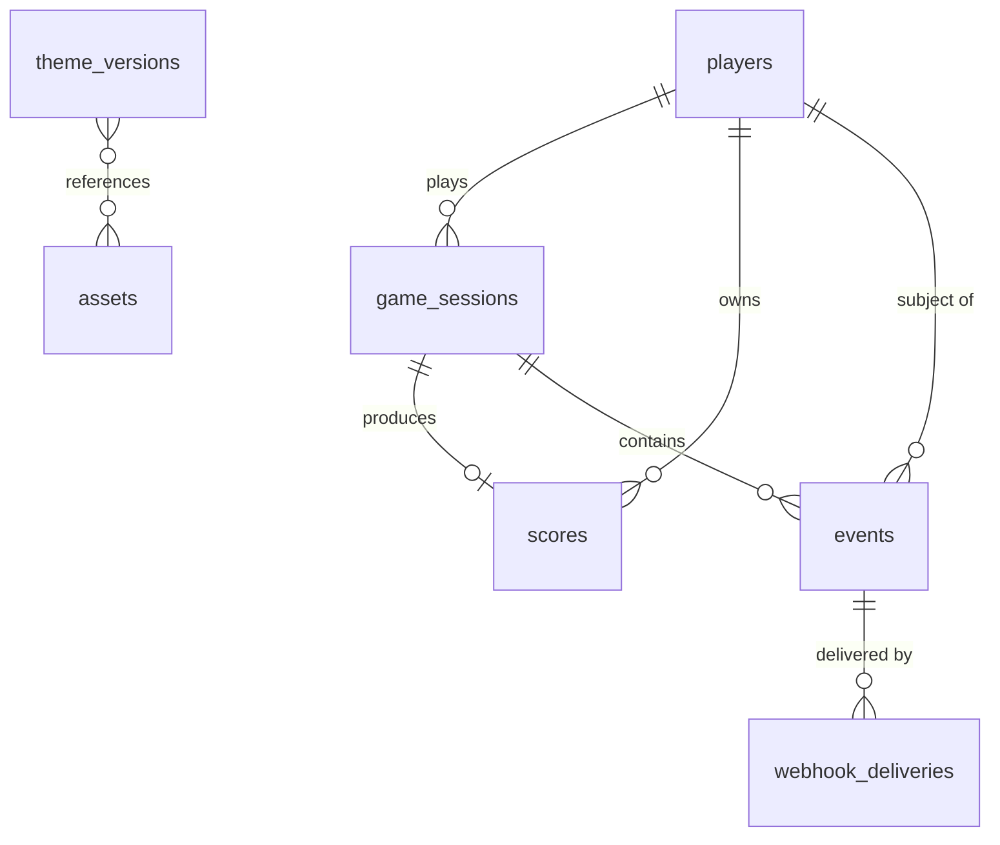

# Data Model (SQLite)

- Engine: SQLite 3 via `better-sqlite3`. Pragmas on connect: `journal_mode=WAL`, `synchronous=NORMAL`, `foreign_keys=ON`, `busy_timeout=5000`.
- All timestamps stored as **INTEGER Unix epoch milliseconds (UTC)**; API serialises to ISO-8601.
- IDs: prefixed ULIDs stored as TEXT (`plr_`, `ses_`, `scr_`, `evt_`, `ast_`, `dlv_`).
- JSON columns stored as TEXT, validated in the service layer (zod) before write.
- Only `server/repositories/*` contain SQL. Every repository exports plain functions so a PostgreSQL implementation can be dropped in (v2).



## Tables

### `players`
| Column | Type | Notes |
|---|---|---|
| `id` | TEXT PK | `plr_…` |
| `mode` | TEXT NOT NULL | `host` \| `anonymous` |
| `external_user_id` | TEXT NULL | From launch token `sub`; UNIQUE when not null |
| `device_id` | TEXT NULL | Anonymous players; UNIQUE when not null |
| `display_name` | TEXT NOT NULL | 3–20 chars |
| `banned_at` | INTEGER NULL | |
| `ban_reason` | TEXT NULL | |
| `created_at`, `last_seen_at` | INTEGER NOT NULL | |

Indexes: `UNIQUE(external_user_id) WHERE external_user_id IS NOT NULL`, `UNIQUE(device_id) WHERE device_id IS NOT NULL`, `(display_name)`.

### `game_sessions`
| Column | Type | Notes |
|---|---|---|
| `id` | TEXT PK | `ses_…` |
| `player_id` | TEXT FK → players | |
| `seed` | INTEGER NOT NULL | uint32 |
| `theme_version` | INTEGER NOT NULL | |
| `status` | TEXT NOT NULL | `open` \| `completed` \| `rejected` \| `abandoned` |
| `started_at` | INTEGER NOT NULL | |
| `ended_at` | INTEGER NULL | |
| `score`, `max_height`, `duration_ms` | INTEGER NULL | as reported |
| `end_reason` | TEXT NULL | `fell` \| `monster` \| `black_hole` \| `quit` \| `abandoned` |
| `reject_reason` | TEXT NULL | |
| `stats` | TEXT (JSON) NULL | |
| `client_info` | TEXT (JSON) NULL | |
| `client_event_count` | INTEGER NOT NULL DEFAULT 0 | cap 2 000 |
| `end_response` | TEXT (JSON) NULL | cached response for idempotent `/end` |

Indexes: `(player_id, started_at DESC)`, `(status, started_at)` (cleanup job).

### `scores`
One row per **accepted** run (leaderboard source).
| Column | Type | Notes |
|---|---|---|
| `id` | TEXT PK | `scr_…` |
| `player_id` | TEXT FK | |
| `session_id` | TEXT FK UNIQUE | |
| `score` | INTEGER NOT NULL | |
| `achieved_at` | INTEGER NOT NULL | |
| `day_key` | TEXT NOT NULL | `YYYY-MM-DD` (UTC) |
| `week_key` | TEXT NOT NULL | ISO week `YYYY-Www` (UTC) |
| `hidden_at` | INTEGER NULL | moderation |
| `hidden_reason` | TEXT NULL | |

Indexes: `(day_key, score DESC, achieved_at)`, `(week_key, score DESC, achieved_at)`, `(score DESC, achieved_at)`, `(player_id, score DESC)`.

Leaderboard query (period = weekly):
```sql
WITH best AS (
  SELECT s.player_id, s.score, s.achieved_at,
         ROW_NUMBER() OVER (PARTITION BY s.player_id ORDER BY s.score DESC, s.achieved_at ASC) AS rn
  FROM scores s JOIN players p ON p.id = s.player_id
  WHERE s.week_key = :weekKey AND s.hidden_at IS NULL AND p.banned_at IS NULL
)
SELECT player_id, score, achieved_at,
       RANK() OVER (ORDER BY score DESC, achieved_at ASC) AS rank
FROM best WHERE rn = 1
ORDER BY rank LIMIT :limit OFFSET :offset;
```
(Ties: `RANK()` on `(score DESC, achieved_at ASC)` → earlier achiever ranks higher; identical timestamps share rank.)

### `events`
| Column | Type | Notes |
|---|---|---|
| `seq` | INTEGER PRIMARY KEY AUTOINCREMENT | cursor (AUTOINCREMENT ensures never reused after purge) |
| `id` | TEXT NOT NULL UNIQUE | `evt_…` |
| `type` | TEXT NOT NULL | |
| `version` | INTEGER NOT NULL | |
| `category` | TEXT NOT NULL | |
| `trust` | TEXT NOT NULL | `server` \| `client` |
| `occurred_at` | INTEGER NOT NULL | |
| `received_at` | INTEGER NOT NULL | |
| `player_id` | TEXT NULL FK | |
| `external_user_id` | TEXT NULL | denormalised for fast filtering |
| `session_id` | TEXT NULL FK | |
| `client_event_id` | TEXT NULL | dedupe client batches |
| `data` | TEXT (JSON) NOT NULL | |

Indexes: `(type, seq)`, `(category, seq)`, `(player_id, seq)`, `(external_user_id, seq)`, `(session_id, seq)`, `(occurred_at)`, `UNIQUE(session_id, client_event_id) WHERE client_event_id IS NOT NULL`.

Writes: client batches inserted in a single transaction. Purge job (daily): `DELETE FROM events WHERE received_at < :cutoff` in chunks of 10 000.

### `webhook_deliveries`
| Column | Type | Notes |
|---|---|---|
| `id` | TEXT PK | `dlv_…` |
| `event_seq` | INTEGER FK → events.seq | ON DELETE CASCADE |
| `url` | TEXT NOT NULL | target at enqueue time |
| `status` | TEXT NOT NULL | `pending` \| `delivered` \| `failed` |
| `attempts` | INTEGER NOT NULL DEFAULT 0 | |
| `next_attempt_at` | INTEGER NOT NULL | |
| `last_status_code` | INTEGER NULL | |
| `last_error` | TEXT NULL | truncated 500 chars |
| `last_duration_ms` | INTEGER NULL | |
| `created_at`, `updated_at` | INTEGER NOT NULL | |

Index: `(status, next_attempt_at)`.

### `theme_versions`
| Column | Type | Notes |
|---|---|---|
| `version` | INTEGER PK | 0 = bundled defaults (seeded) |
| `theme` | TEXT (JSON) NOT NULL | validated by `shared/themeSchema.js` |
| `note` | TEXT NULL | |
| `published_at` | INTEGER NOT NULL | |

### `theme_draft`
Single-row table (`id = 1`): `theme` TEXT JSON, `updated_at` INTEGER, `base_version` INTEGER.

### `assets`
| Column | Type | Notes |
|---|---|---|
| `id` | TEXT PK | `ast_…` |
| `sha256` | TEXT NOT NULL UNIQUE | content hash; duplicate upload returns existing |
| `file_name` | TEXT NOT NULL | `<sha256>.<ext>` in `UPLOAD_DIR` |
| `original_name` | TEXT NOT NULL | |
| `mime` | TEXT NOT NULL | |
| `kind` | TEXT NOT NULL | `image` \| `audio` |
| `bytes` | INTEGER NOT NULL | |
| `width`, `height` | INTEGER NULL | images |
| `created_at` | INTEGER NOT NULL | |

Theme JSON references assets by **URL** (`/uploads/<file_name>`); "in use" check scans draft + all published versions (small data, acceptable).

### `settings`
Key–value: `key` TEXT PK, `value` TEXT JSON, `updated_at` INTEGER.
Keys: `gameplay`, `webhook` (secret stored encrypted with AES-256-GCM using a key derived from `ADMIN_JWT_SECRET` via HKDF), `antiCheat`.
Env values seed defaults on first boot; admin edits override afterwards.

### `used_launch_tokens`
`jti` TEXT PK, `expires_at` INTEGER — replay protection, purged hourly.

### `schema_migrations`
`version` INTEGER PK, `applied_at` INTEGER.

## Migrations

- Plain SQL files `server/db/migrations/NNN_name.sql`, applied in order at boot inside a transaction; recorded in `schema_migrations`.
- Forward-only. Destructive changes require a new migration that copies data.
- `001_init.sql` creates all tables above and seeds `theme_versions(version=0)` with the default theme from `shared/themeSchema.js` (seeded by `migrate.js`, since JSON comes from code).

## Background jobs (in-process, `setInterval`)

| Job | Interval | Action |
|---|---|---|
| Webhook dispatcher | 1 s | Send due `pending` deliveries |
| Session cleanup | 5 min | `open` sessions older than 2 h → `abandoned` + `game.ended` event |
| Event retention | 24 h | Purge old events (cascade deliveries) |
| Launch-token purge | 1 h | Delete expired `used_launch_tokens` |
